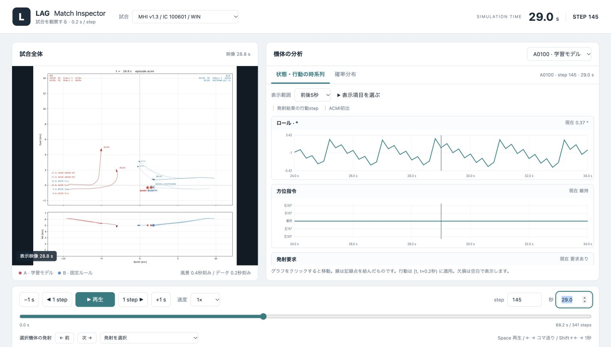

# Experiment 13: LAGデータ統合・ACMI inspection

LAG 2v2 のACMIとaction CSVをDataFrameとして読み、型・shape・欠損・統計量・機体と行動の時系列を確認する。

## 試合ビューアー

左に録画、右に状態・行動のグラフを並べて同期閲覧する。確率分布／時系列を切り替え、0.2秒刻みでコマ送りできる。

リポジトリルートから、次のコマンドで起動する（pandas、ffmpeg、ffprobeが必要）。

```sh
.venv/bin/python experiments/13_LAG/viewer/serve.py
```

起動するとブラウザで <http://127.0.0.1:8130/viewer/> が開く。自動で開かない場合は、このURLにアクセスする。終了はターミナルで `Ctrl+C`。初回起動時は録画から表示用フレームを生成する。



表示例：MHI v1.3 / IC 100601、A0100、145 step。試合・機体を選び、下部のstep入力やスライダーで場面を移動できる。操作と時刻の意味は [viewer/README.md](viewer/README.md) を参照。

## 実験用の統合CSV

3試合それぞれについて、A・Bチームの4機体、全ミサイル、撃墜・爆発の表示、元データの状態・行動・確率・発射・消滅を、1時刻×1オブジェクトのCSVに統合した。
保存先は[`data/processed/`](data/processed/)。Bチームの選択行動・ミサイルの制御指令・rewardは未収録で、推定補完していない。

**列定義、時刻・欠損・精度の規則、履歴長・機体・ミサイルを切り替えるコード例は[統合CSVの設計と利用方法](data/processed/README.md)を参照。**

| ファイル | 行数 |
|---|---:|
| [`mhi_v1.3_ic100601_win.csv`](data/processed/mhi_v1.3_ic100601_win.csv) | 2,124 |
| [`ours_seed100100_ic100601_loss.csv`](data/processed/ours_seed100100_ic100601_loss.csv) | 1,893 |
| [`ours_seed100100_ic100606_win.csv`](data/processed/ours_seed100100_ic100606_win.csv) | 3,016 |

全ファイルは64列、原本の数値文字列を保持する。出典・SHA-256・件数・型は[`manifest.json`](data/processed/manifest.json)に記録。
原本は変更せず、間引き・補間・状態の丸め・行動の穴埋めも行わない。

リポジトリルートから：

```sh
.venv/bin/python experiments/13_LAG/run.py
.venv/bin/python experiments/13_LAG/run.py --check
.venv/bin/python -m pytest experiments/13_LAG/tests -q
```

[`lag_data/dataset.py`](lag_data/dataset.py)はpandasによる型付き読み込み・履歴時点選択・機体別レコード抽出を提供する。
4課題の入力と正解の分離、プロンプト、推論・採点は[Experiment 14](../14_mental-modeling_LAG/README.md)に置く。13には実験条件やLLMへの依存を持たせない。

## 構成

- `data/raw/20261005_LAG_2v2_ACMI/`: 受領したACMI 3本、説明メモ、`recordings/`の動画3本。
- `data/raw/20261005_LAG_2v2_ACMI/actions/`: 対応する行動CSV 3本とREADME（ディレクトリをそのままコピー）。
- `data/raw/manifest.json`: コピーした11ファイルの相対パス・サイズ・SHA-256。
- `data/viz/inspect_acmi.ipynb`: データ確認Notebook（実行結果付き）。
- `data/viz/acmi_loader.py`: 今回の6成分Tレコード用ローダー。
- `data/processed/`: 実験条件に依存しない3試合の統合CSV、manifest、詳細README。
- `run.py`: 統合CSV生成・照合のエントリポイント。
- `lag_data/definitions.py`: 64列スキーマ、機体・行動ID・状態10成分・単位の共通定義。
- `lag_data/prepare.py`: 統合CSVの再生成・元データ照合。
- `lag_data/dataset.py`: 型付き読み込み、時刻・機体・特徴量の抽出。
- `tests/test_dataset.py`: データ保持・時刻対応・抽出・再現性を検証。

旧`prepare_data.py`は`run.py`へ、旧`dataset.py`のデータ処理は`lag_data/dataset.py`へ移動した。旧`make_query()`の実験固有処理は廃止し、14の`runner.build_query()`で4課題を構築する。保存CSVの内容は変更していない。

出典: MTD-RL共有ドライブの `01_Vault/sources/YutaSawada/20261005_LAG_2v2_ACMI/`。
原本のディレクトリ構造と内容を保持し、Finderの`.DS_Store`のみ除外した。

## 実行

リポジトリルートから、既存のPython環境を使用する。

```sh
.venv/bin/python -m jupyterlab experiments/13_LAG/data/viz/inspect_acmi.ipynb
```

依存関係がない環境では `python -m pip install -e '.[notebook]'` で導入する。
Notebookの`ACMI_FILE`を変更し、上から全セルを実行する。

- `acmi`: 選択ファイルのpandas DataFrame。1行は1オブジェクトの更新。
- `acmi_text`: BOMを除いた原文文字列。
- `metadata`: ヘッダー・グローバル属性。
- `removals`: オブジェクト削除記録。
- `aircraft`: `Name == "F16"` の更新行。
- `acmi_by_file`: ファイル名からDataFrameを取得できる辞書。
- `actions`: 選択したACMIと同じ試合のCSV全体。
- `policy_actions`: 生存中の学習モデル側の状態・行動・確率。
- `action`: 高度・方位・速度・射撃の4列。
- `action_probabilities`: 行動選択肢の確率13列。
- `actions_with_acmi`: 時刻ステップと機体IDでACMIの状態を結合した表。
- `actions_by_file`: 全3試合のCSVを保持する辞書。

ACMIはイベント形式なので、未記載の属性は欠損のまま保持し、状態の補完はしない。
本ローダーは今回のファイルに合わせたもので、汎用Tacviewパーサーではない。
オブジェクトごとの最終更新時刻は撃墜時刻を意味しない。
角度の統計は算術統計であり、循環角の平均ではない。

行動CSVの空欄は青側と撃墜後の行動・確率には値がないことを表す。
`shoot_action=yes`（発射意思）と`missile_launched`（実際の発射）を分けて確認する。
詳細な列定義はコピーした`actions/README.md`を参照。CSVにはモデルの観測ベクトルやRNN内部状態は含まれない。
