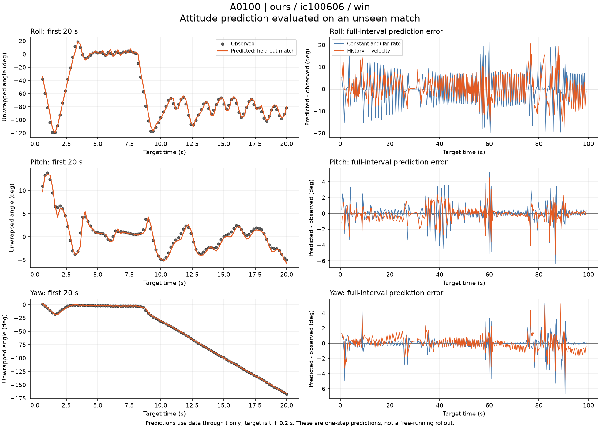
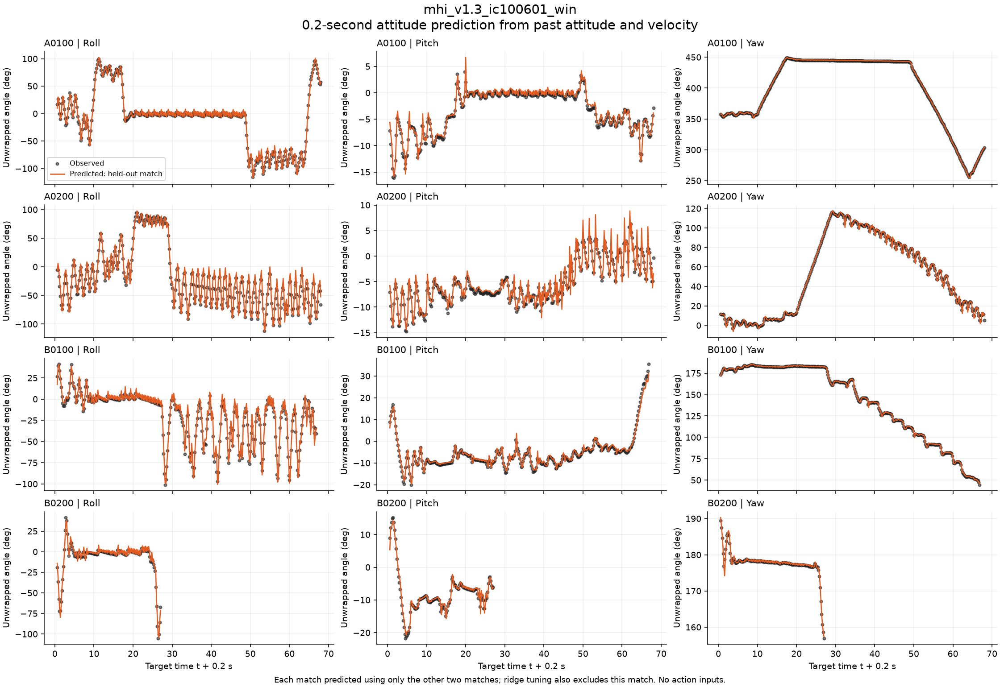
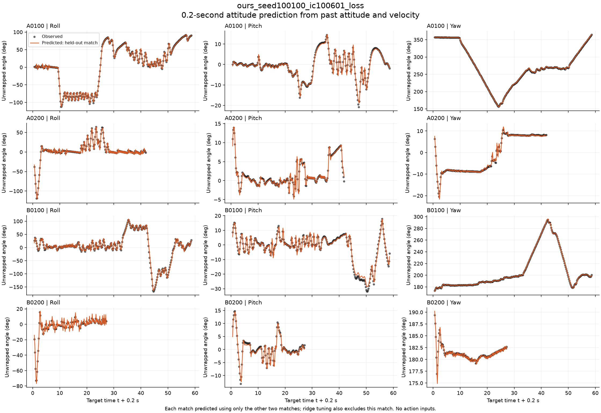
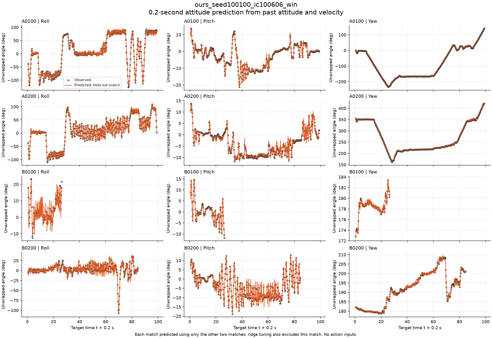
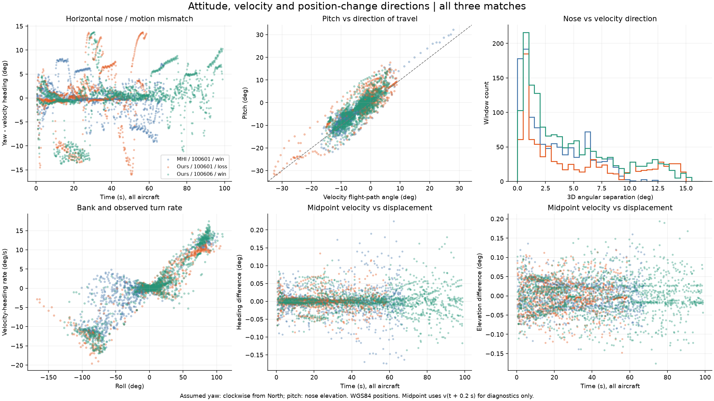

# 姿勢角の0.2秒先予測と、機首・速度・位置変化の関係

作成日：2026-10-13（JST）

## 結果の要点

3試合・各4機から抽出した3,601区間について、現在と過去2時刻の姿勢角・速度から、0.2秒先のロール・ピッチ・ヨーを予測した。姿勢角ごとに異なる回帰式を用い、各式の係数は機体間で共通とした。機体・試合IDは入力に含めていない。

- 姿勢角履歴＋速度モデルの試合外検証RMSEは、ロール **6.057°**、ピッチ **1.355°**、ヨー **1.059°**。
- 直前の角速度を維持する外挿より誤差は小さい。一方、姿勢角履歴だけの回帰と比較すると、速度の追加による明確な改善は見られなかった。
- 機首方向と速度方向の3次元角度差は中央値 **2.927°**、95パーセンタイル **12.773°**。両者は同じ方向とは限らない。
- 区間両端の速度平均と位置差分方向の角度差は中央値 **0.0384°**。位置変化は速度方向とよく整合する。

**掲載した予測図は、対象試合を学習から除外した予測である。以下の係数表は、再利用用に全3試合で学習した最終モデルであり、図を描いたモデルそのものではない。**

## 使用データと抽出条件

対象は次の行動CSV。`uid` ごとに時刻を整列し、4時刻 $n-2,n-1,n,n+1$ が連続し、すべて生存中、各間隔が0.2秒の区間だけを採用した。試合や機体をまたぐ差分は作成していない。残差の大きさを理由にした除外はない。

| 試合 | 有効区間数 | 入力CSV |
|---|---:|---|
| MHI / ic100601 / 勝ち | 1,141 | [mhi_v1.3_ic100601_win_actions.csv](../../data/raw/20261005_LAG_2v2_ACMI/actions/mhi_v1.3_ic100601_win_actions.csv) |
| 学習モデル / ic100601 / 負け | 923 | [ours_seed100100_ic100601_loss_actions.csv](../../data/raw/20261005_LAG_2v2_ACMI/actions/ours_seed100100_ic100601_loss_actions.csv) |
| 学習モデル / ic100606 / 勝ち | 1,537 | [ours_seed100100_ic100606_win_actions.csv](../../data/raw/20261005_LAG_2v2_ACMI/actions/ours_seed100100_ic100606_win_actions.csv) |

列の意味は [データREADME](../../data/raw/20261005_LAG_2v2_ACMI/README.md) と [actions README](../../data/raw/20261005_LAG_2v2_ACMI/actions/README.md) に基づく。禁止指定された元メモは読んでいない。

## 回帰式

### 記号と角度処理

$$
\mathbf q_n=(\phi_n,\theta_n,\psi_n)^\top
$$

$\phi$ はロール、$\theta$ はピッチ、$\psi$ はヨー。角度の単位は度、速度はm/s、時間間隔は $\Delta t=0.2\,\mathrm{s}$ とする。

$$
\operatorname{wrap}(a)=((a+180)\bmod360)-180
$$

$$
\mathbf d_n=\operatorname{wrap}(\mathbf q_n-\mathbf q_{n-1}),
\qquad
\mathbf d_{n-1}=\operatorname{wrap}(\mathbf q_{n-1}-\mathbf q_{n-2}).
$$

`wrap` は成分ごとに適用する。例えばヨーが359°から1°へ変化した場合、増分は−358°ではなく+2°とする。図では角度を連続化して表示しているため、ヨーが負や360°超になる場合がある。

### 入力と出力

$\mathbf v_n=(v_{N,n},v_{E,n},v_{U,n})^\top$、$s_n=\mathrm{TAS}_n$ とする。

姿勢角履歴だけの12次元入力は

$$
\mathbf x_n^{(H)}=
\begin{bmatrix}
\mathbf d_n\\
\mathbf d_{n-1}\\
\sin(\pi\mathbf q_n/180)\\
\cos(\pi\mathbf q_n/180)
\end{bmatrix}.
$$

速度を加えた24次元入力は

$$
\mathbf x_n^{(HV)}=
\begin{bmatrix}
\mathbf x_n^{(H)}\\
\mathbf v_n\\
\mathbf v_n-\mathbf v_{n-1}\\
\mathbf v_{n-1}-\mathbf v_{n-2}\\
s_n\\
s_n-s_{n-1}\\
s_{n-1}-s_{n-2}
\end{bmatrix}.
$$

速度の差分はそのままm/sで入力し、0.2秒では割っていない。姿勢角の差分も度のままで、角速度への換算はしていない。入力はすべて時刻 $n$ 以前の情報である。

回帰対象と予測式は

$$
\mathbf y_n=\operatorname{wrap}(\mathbf q_{n+1}-\mathbf q_n),
$$

$$
\boxed{\widehat{\mathbf q}_{n+1}=\mathbf q_n+\mathbf b+B^\top\mathbf x_n}.
$$

$B$ は入力数×3の係数行列、$\mathbf b$ は3成分の切片である。下の係数表では「行＝入力、列＝予測する姿勢角」とする。ロール予測にもピッチ・ヨーの履歴が入り、成分間の関係を含めた回帰になっている。sin/cosを含む特徴量に対して線形なモデルであり、姿勢の厳密な運動方程式を同定したものではない。

### 推定方法

各学習分割の入力を、その学習データだけの平均・標準偏差で標準化し、出力ごとにridge回帰を行った。

$$
\min_{\beta_j,c_j}
\sum_{i\in\mathrm{train}}
(y_{ij}-c_j-\mathbf z_i^\top\beta_j)^2
+\alpha_j\|\beta_j\|_2^2.
$$

切片は罰則の対象外。サンプルの重みは一律であり、長い生存区間を持つ機体・試合ほど寄与する。$\alpha_j$ の候補は `0, 0.001, 0.1, 1, 10, 100, 1000`。

**以下は標準化を元に戻した係数である。そのまま上記の単位の入力に適用でき、再度標準化する必要はない。** 表は有効数字10桁に丸めており、保存精度の値は [results.json](results.json) の `final_models` にある。

## 全3試合で学習した最終係数

### 姿勢角履歴＋速度の回帰

選択されたridge係数 α（ロール・ピッチ・ヨー順）：`[100.0, 100.0, 100.0]`。

| 入力 | ロール増分への係数 | ピッチ増分への係数 | ヨー増分への係数 |
|---|---:|---:|---:|
| 切片 b | -14.76180681 | 4.294317607 | -2.520525381 |
| `previous_increment_Roll_deg` | 0.8739996007 | -0.01653091406 | 0.03362385011 |
| `previous_increment_Pitch_deg` | 0.04311614363 | 0.7263278474 | -0.008168422444 |
| `previous_increment_Yaw_deg` | 1.051024867 | -0.04783275174 | 0.4686347507 |
| `earlier_increment_Roll_deg` | -0.4456160197 | 0.02723564489 | -0.01542850822 |
| `earlier_increment_Pitch_deg` | -0.1077633176 | -0.1342498868 | -0.04605107816 |
| `earlier_increment_Yaw_deg` | -0.06893509116 | -0.08384646053 | -0.08923186335 |
| `sin_Roll` | -3.414637313 | 0.4269037412 | 1.178682684 |
| `sin_Pitch` | -5.032223122 | -1.673127881 | -0.4425107532 |
| `sin_Yaw` | 0.4184387499 | -0.04488083873 | 0.284022176 |
| `cos_Roll` | -1.002246932 | 0.3517048943 | -0.3383312001 |
| `cos_Pitch` | 17.39283546 | -4.875497792 | 3.052633361 |
| `cos_Yaw` | -0.2324527162 | 0.02432485523 | 0.05332922339 |
| `velocity_N_mps` | 0.0002495911679 | 0.000289456948 | -0.0002994246565 |
| `velocity_E_mps` | -0.003789941226 | 0.0005559259243 | -3.648700731e-05 |
| `velocity_U_mps` | 0.009065134935 | -3.741634738e-05 | -0.0006555618184 |
| `velocity_last_difference_N_mps` | 0.1008199864 | -0.02020587769 | -0.005702172514 |
| `velocity_last_difference_E_mps` | -0.04749467937 | -0.01956425272 | 0.005509768713 |
| `velocity_last_difference_U_mps` | -0.4224439375 | -0.1113083877 | 0.05740684084 |
| `velocity_earlier_difference_N_mps` | 0.01231771602 | 0.02803298784 | 0.04195179531 |
| `velocity_earlier_difference_E_mps` | 0.06415402441 | 0.01803767047 | -0.01340692382 |
| `velocity_earlier_difference_U_mps` | 0.4324376241 | 0.003439254383 | -0.01701964871 |
| `tas_mps` | -0.006768785369 | 0.0008533389582 | -0.001026035345 |
| `tas_last_difference_mps` | 0.7822913529 | -0.1963366513 | 0.1107325927 |
| `tas_earlier_difference_mps` | -0.6337575871 | 0.0255021747 | -0.05595739225 |
### 姿勢角履歴だけの回帰

選択されたridge係数 α（ロール・ピッチ・ヨー順）：`[10.0, 100.0, 100.0]`。

| 入力 | ロール増分への係数 | ピッチ増分への係数 | ヨー増分への係数 |
|---|---:|---:|---:|
| 切片 b | -12.35859331 | 4.240062228 | -2.800289999 |
| `previous_increment_Roll_deg` | 0.9824516679 | -0.01064397419 | 0.03279284129 |
| `previous_increment_Pitch_deg` | -0.3165799853 | 0.6885604529 | 0.01530743127 |
| `previous_increment_Yaw_deg` | 1.12839338 | -0.06119248423 | 0.4991982403 |
| `earlier_increment_Roll_deg` | -0.5730157904 | 0.02544295937 | -0.01674261635 |
| `earlier_increment_Pitch_deg` | -0.123955682 | -0.2295819892 | -0.007965069192 |
| `earlier_increment_Yaw_deg` | 0.005067360992 | -0.09183378381 | -0.09448107354 |
| `sin_Roll` | -3.500761379 | 0.456958984 | 1.166448687 |
| `sin_Pitch` | -1.797074017 | -2.049024639 | -0.2221959839 |
| `sin_Yaw` | -0.7962508644 | 0.1221290549 | 0.226829182 |
| `cos_Roll` | -0.5834667391 | 0.08733276406 | -0.1951396355 |
| `cos_Pitch` | 12.72339083 | -4.421157515 | 2.969641696 |
| `cos_Yaw` | -0.1705340878 | 0.1008833064 | -0.01292434252 |

## 検証方法と結果

外側では「2試合で学習、残る1試合で検証」を3通り行った。検証対象の試合は、標準化・係数推定・ridge係数選択のどれにも使用していない。ridge係数は、残る2試合についてさらに「1試合で学習、もう1試合で検証」を入れ替えて選択した。

再利用用の最終モデルは、3試合による試合単位の交差検証でridge係数を選んだ後、全データに再フィットした。

予測誤差は

$$
e_{ij}=\operatorname{wrap}(\widehat q_{n+1,j}-q_{n+1,j}),
\qquad
\mathrm{RMSE}_j=\sqrt{\frac1N\sum_i e_{ij}^2}.
$$

集計値は、3回の検証予測を合わせた3,601区間に対する値。試合別RMSEの単純平均ではない。

### 試合外検証のRMSE

| 方法 | ロール（度） | ピッチ（度） | ヨー（度） |
|---|---:|---:|---:|
| 現在の姿勢角を維持 | 9.761655 | 1.715716 | 1.666626 |
| 直前の角速度を維持 | 8.104126 | 1.598997 | 1.183867 |
| 角加速度一定で外挿 | 9.389485 | 2.215472 | 1.785903 |
| 姿勢角履歴だけの回帰 | 5.845100 | 1.361671 | 1.058343 |
| 姿勢角履歴＋速度の回帰 | 6.056524 | 1.355167 | 1.059124 |

比較法はそれぞれ、角度増分を0、$\mathbf d_n$、$2\mathbf d_n-\mathbf d_{n-1}$ と予測する。

速度を追加すると、姿勢角だけの回帰に対してロールは悪化し、ピッチはわずかに改善、ヨーはほぼ同じだった。この結果は今回の特徴量・回帰法での比較であり、速度に予測情報がないこと一般を示すものではない。

### 姿勢角履歴＋速度モデルの試合別検証

| 学習から除外した試合 | 区間数 | ロールRMSE | ピッチRMSE | ヨーRMSE | α（ロール・ピッチ・ヨー） |
|---|---:|---:|---:|---:|---|
| MHI / ic100601 / 勝ち | 1141 | 7.241534° | 1.271466° | 1.361552° | [10.0, 100.0, 100.0] |
| 学習モデル / ic100601 / 負け | 923 | 4.520316° | 1.332062° | 0.764311° | [100.0, 100.0, 100.0] |
| 学習モデル / ic100606 / 勝ち | 1537 | 5.894115° | 1.427225° | 0.949266° | [100.0, 100.0, 100.0] |

### 誤差分布と学習データへの当てはまり

| 指標（姿勢角履歴＋速度） | ロール | ピッチ | ヨー |
|---|---:|---:|---:|
| 試合外検証 MAE | 4.749067° | 0.909968° | 0.657896° |
| 試合外検証 絶対誤差95パーセンタイル | 12.152843° | 3.063397° | 2.147050° |
| 試合外検証 最大絶対誤差 | 24.866294° | 7.809321° | 9.356878° |
| 全データ再フィット時の学習RMSE | 5.639605° | 1.258637° | 0.988556° |

学習RMSEと試合外検証RMSEは異なる。予測図に使用した時刻別の実測・予測・誤差は [heldout_predictions.csv](heldout_predictions.csv)、機体別の集計は [results.json](results.json) の `by_match_and_aircraft` を参照。

## 実データと姿勢角予測の重ね合わせ

黒点は実測、オレンジ線は姿勢角履歴＋速度による試合外予測。各試合について、他の2試合から学習した係数を全4機に共通で適用している。試合を入れ替えると学習データが変わるため、3つの検証図の係数は同一ではない。

毎時刻、実測された過去状態を入力して1ステップ先を予測している。予測値を次の入力に繰り返し戻す長期ロールアウトではない。

### A0100・学習モデル勝ち試合の拡大図

左列は最初の20秒、右列は全生存区間の予測誤差。右列の青線は角速度一定の外挿、オレンジ線は回帰モデル。



### MHIモデル・ic100601・勝ち（全4機）



### 学習モデル・ic100601・負け（全4機）



### 学習モデル・ic100606・勝ち（全4機）



## 姿勢角・速度・位置差分の関係

### 比較した方向

北・東・上の座標系で、ヨーを北から時計回り、ピッチを機首の仰角と仮定すると、機首の前方単位ベクトルは

$$
\mathbf f_n=
\begin{bmatrix}
\cos\theta_n\cos\psi_n\\
\cos\theta_n\sin\psi_n\\
\sin\theta_n
\end{bmatrix}.
$$

ここで三角関数には角度をラジアンに変換して渡す。ロールは前方軸を中心とする回転なので、この前方軸ベクトルには直接入らない。

速度から求める移動方位と上下方向の角度は

$$
\chi_n=\operatorname{atan2}(v_{E,n},v_{N,n}),
\qquad
\gamma_n=\operatorname{atan2}
\left(v_{U,n},\sqrt{v_{N,n}^2+v_{E,n}^2}\right).
$$

2つの非零ベクトルの3次元角度差は

$$
\eta(\mathbf a,\mathbf b)=
\arccos\left(\frac{\mathbf a\cdot\mathbf b}{\|\mathbf a\|\|\mathbf b\|}\right).
$$

位置はWGS84の測地緯度・楕円体高と仮定してECEFに変換し、$\mathbf r_{n+1}-\mathbf r_n$ を時刻 $n$ の北・東・上座標へ投影した。局所速度も各時刻でECEFへ回転してから両端の平均を取り、同じ座標系で比較した。

位置差分は0.2秒の区間の移動を表すため、時刻 $n$ の瞬間速度との比較に加え、両端速度の平均

$$
\overline{\mathbf v}_n=
\frac{\mathbf v_n^{\mathrm{ECEF}}+\mathbf v_{n+1}^{\mathrm{ECEF}}}{2}
$$

との比較も行った。**この両端平均は整合性の診断用であり、未来の姿勢角予測の入力には使用していない。**

### 方向差の集計

| 比較 | RMSE（度） | 絶対値の中央値（度） | 絶対値95パーセンタイル（度） |
|---|---:|---:|---:|
| ヨー − 速度方位 | 4.816248 | 1.216319 | 11.975484 |
| ピッチ − 速度の上下方向角 | 3.280788 | 1.682549 | 7.216893 |
| 機首と速度の3D角度差 | 5.783808 | 2.927211 | 12.773072 |
| 瞬間速度方位 − 位置差分方位 | 0.627070 | 0.083076 | 1.351157 |
| 瞬間速度仰角 − 位置差分仰角 | 0.351197 | 0.154598 | 0.768152 |
| 両端速度平均と位置差分の3D角度差 | 0.054541 | 0.038404 | 0.106733 |

ロールと次の0.2秒間の速度方位変化率

$$
\dot\chi_n\approx\frac{\operatorname{wrap}(\chi_{n+1}-\chi_n)}{0.2}
$$

の標本相関は **0.9021**。旋回とバンクの関連は見られるが、時系列の各点は独立標本ではなく、因果関係を同定した結果ではない。



上段は、機首と速度の方位差、ピッチと移動の上下方向角、機首と速度の3D角度差。下段は、ロールと速度方位変化率、両端速度平均と位置差分の方位差・仰角差。色は試合を表し、各試合の4機をまとめている。

## 前提・限界・未確認事項

- READMEだけではEuler角の厳密な規約、緯度・高度の厳密な定義、風および速度ベクトルの対地・対気の扱いを確定できない。方向比較は上記の規約とWGS84を仮定した結果。
- 機首と速度の方向差を、空気力学上の迎角や横滑り角と断定していない。
- 3試合中2試合は同じ初期配置 `ic100601`。試合単位では学習・検証を分離したが、完全に独立した初期配置への一般化を確認したものではない。
- 行動・舵角・角速度は回帰入力に使っていない。モデルは状態履歴からの経験的な短期予測であり、操縦入力に対する姿勢運動の法則ではない。
- 図は1ステップ予測。実測の過去状態を使わずに長期予測した場合の誤差は未検証。
- 実測のピッチは±90°から離れている。本モデルの大きな姿勢変化やEuler角の特異点付近への適用は未検証。

## 保存物と再現

- [解析スクリプト](analyze.py)：入力抽出、回帰、試合外検証、方向比較、作図。
- [全数値結果・係数](results.json)：検証結果、全データで学習した係数、入力ファイルのSHA-256。
- [時刻別の試合外予測](heldout_predictions.csv)：実測角度、予測角度、角度誤差。
- [テキスト要約](summary.txt)。
- [先行する位置差分・速度の解析](../velocity_position_fit_20261013/summary.txt)：姿勢角予測とは別の解析。

`analyze.py` は同階層の先行解析にある `../velocity_position_fit_20261013/fit.py` のCSVパス・座標変換を利用する。NumPyとMatplotlibが利用できる環境で、リポジトリルートから次を実行する。

```bash
.venv/bin/python experiments/13_LAG/analysis/attitude_prediction_20261013/analyze.py
```

解析スクリプトは数値結果・CSV・画像・テキスト要約を再生成する。このMarkdownは再生成しないため、モデルを変更して再実行した場合は本文・係数表も更新すること。

